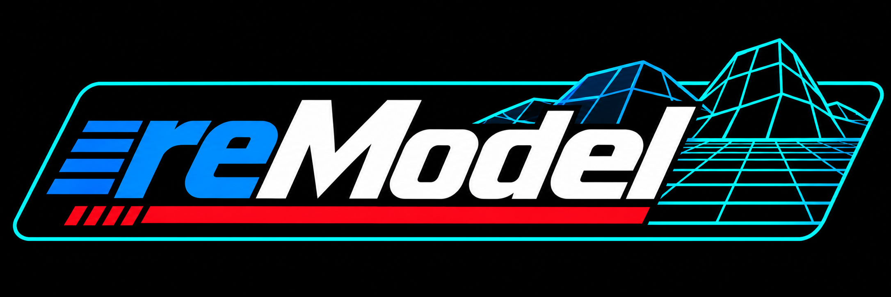

<p align="center"></p>

# Remodel

**Static recompilation toolkit for Sega Model 2 arcade games.**

Remodel turns the program code of a Model 2 game into native code that runs
on a modern PC, with the custom hardware (geometry processor, renderer, sound)
replaced by high-level reimplementations. The first target is *Top Skater*
(`topskatr`); everything not specific to one game is built to be reused across
the Model 2 family.

> **Bring your own ROMs.** Remodel contains no game code or data. It reads a
> dump you supply at runtime and checks it against known-good hashes. Never
> commit ROM files or generated listings: `rom/` and `out/` are git-ignored.

## Status

The original program runs on the reference interpreters from boot through
attract, coin-up, course and skater select into a race, with textured 3D
frames written as PNG snapshots. The interpreters run the bench (attract into
a race) at about 2x real time on a desktop CPU, with the geometrizer on its
own thread. The sound board (68000 + SCSP) and the DSB2 MPEG music board
render offline from the command bytes a run captures (`make sound`, `make
music`). There is no live window yet.

| Stage | State |
|---|---|
| ROM set loading and verification | done |
| i960 disassembler | done |
| Static code discovery | done (~28% of `topskatr` program ROM mapped) |
| i960 interpreter (reference and tracer) | done; boots `topskatr` into its interrupt-driven init |
| Model 2C board model (memory, IRQs, timers, I/O, copro interface) | in progress |
| MB86235 geometry processor: disassembler and reference interpreter | done; runs the game's uploaded program |
| Geometrizer (second MB86235) running the game's own program | done; gameplay frames produce the rasteriser stream |
| Recompiler: i960 → native | done; opt-in (`make recomp`, then `RECOMP=1`), identical state hash; 96% of the game's instructions become plain Rust, the rest call the interpreter with the instruction pre-decoded; see `docs/recompiler.md` |
| Recompiler: MB86235 programs → Rust | done; built with the i960 code, geometrizer about 1.5x faster |
| Geometry processor fast path (high-level per-command) | planned |
| 2D tile layer renderer (PNG snapshots) | done; boot, logo, title and attract text render |
| 3D rasteriser (software) | textured, bilinear-filtered gameplay frames (topskatr uses no mipmaps); the reference, but too slow for live races (15-27 ms a frame at native size) |
| 3D rasteriser (GPU, wgpu: Vulkan / Metal / DirectX 12) | off-screen preflight: about 3 ms a frame native and 7 ms at 1080p, matching the software renderer on 99.96% of coverage; see `docs/gpu.md` |
| Scripted input (headless) | done; names, ports and bindings per game in its manifest; every `topskatr` button and both analog channels confirmed |
| Speed | interpreters about 2.2x real time (`make bench`); recompiled build about 4.4x (`make bench RECOMP=1`), where the geometrizer thread becomes the limit |
| Sound board: 68000 + SCSP (slots, EG, LFO, FM, timers, MIDI, DSP) | done offline: replays the captured command stream to a WAV at about 12x real time |
| DSB2 music board (68000 firmware + MPEG Layer II decoder) | done; `make music` renders the game's music from a `run` capture |
| Enhanced views: any resolution, 16:9 / 21:9 with HUD moved to the edges | done for snapshots (`--height`, `--aspect`, `--hud`) |
| Custom soundtracks (replace any music track, game logic intact) | done offline: `make music SOUNDTRACK=name`; see `docs/mods.md` |
| Native window (`make play`) | playable: GPU renderer, live sound (cpal), keyboard and gamepad (gilrs), any window shape from 4:3 to 32:9; about 2 ms of CPU per frame recompiled. Esc menu (sound mix, display, save slots, game picker), save states; see `docs/play.md` |
| Browser build (WebAssembly + WebGPU) | playable (`make web`), with sound, keyboard and gamepad; see `docs/web.md` |
| Second game: `skisuprg` (Sega Ski Super G, 2C) | playable (`make play GAME=skisuprg`): drive board modelled from the game's code, its own controls and coin-start script from its manifest; save states round-trip |
| Third game: `stcc` (Sega Touring Car Championship, 2C) | playable with sound effects, no music (`make play GAME=stcc`): attract, car and gearbox select, name entry and races; its DSB1 music board (Z80) isn't modelled yet. Needed geometrizer list jumps and mirrored ROM slots; recompiled build identical |

## Quick start

Requires a Rust toolchain (stable) and `make`.

```sh
make                  # list every target
make check            # format check, clippy, unit tests (no ROMs needed)
make m68k-tests       # 68000 core vs the SingleStepTests suite (fetches ~200 MB, 1.1 GB unpacked, into out/)

# With ROM sets in ./rom, as MAME keeps them (rom/topskatr.zip, or unpacked in rom/topskatr/):
make verify           # check every chip
make scan             # list the sets in rom/ (MAME zips or folders) and check the supported ones
make boot             # boot record and system-table entry points
make analyze          # code discovery -> out/topskatr/program.lst
make disasm ADDR=0x6f0 COUNT=64
make run STEPS=50000000   # boot on the interpreter, report hardware use
make run SNAP=60          # also write the tile layer every 60 frames
make run STEPS=900000000 SNAP=115 INPUT=coin-start   # coin-start: the game's own coin-up and start
make inputs               # the game's input names for INPUT=, and their keys and pad bindings
make sound                # render the sound commands of the last run -> out/topskatr/sound.wav
make sound-disasm ADDR=0x6004ea   # disassemble the sound 68000 program
                          # coin up, start, and play into a race
make run STEPS=485000000 INPUT=coin1@1100-1104,start@1250-1254 \
    VIEW="--height 1080 --aspect 21:9 --hud edges"   # enhanced snapshot
make dump-textures        # race run: every 3D texture and tile drawn -> out/topskatr/texdump/
make run STEPS=600000000 INPUT=coin1@1100-1104,start@1250-1254 \
    PACK=out/topskatr/texpack VIEW="--height 1080"   # snapshots with a texture pack (docs/texture-packs.md)
make assets               # extract the game's art for review -> out/topskatr/assets (needs ImageMagick)
make bench                # timed run into a race: speed and state hash
make recomp               # recompile the game's i960 code and TGP programs (after a `run`; ~2 min build)
make bench RECOMP=1       # same run on the recompiled build: same hash, about twice as fast
make play RECOMP=1        # play in a native window (Esc menu, F5/F9 quick save/load, F11 fullscreen)
make web RECOMP=1         # browser build -> out/web (WebGPU; serve over HTTPS, docs/web.md)
make dist                 # player to hand out (interpreter only, no ROMs) -> out/dist/remodel-VERSION-TARGET.tar.gz
make capture              # save renderer inputs from a run into a race -> out/topskatr/capture
make gpu-check            # draw them on the software and GPU rasterisers, time and compare
make lockstep RECOMP=1    # recompiled vs interpreted i960, block by block, until they differ
make music                # after a `run` into a race: DSB2 music -> out/topskatr/music.wav
make soundtrack-import SRC=~/my-mix SOUNDTRACK=my-mix   # your own music (ffmpeg converts)
make music SOUNDTRACK=my-mix      # same, with your tracks -> out/topskatr/music-my-mix.wav
```

Custom soundtracks, their `tracks.txt` format and how the game still drives
them are described in `docs/mods.md`.

`make bench` prints a hash of all RAM and the last rasteriser stream. A change
meant only to make things faster must leave it unchanged. The hash depends on
`out/GAME/eeprom.bin`, which `run` creates on first boot.

Every target takes `GAME=skisuprg` for Sega Ski Super G or `GAME=stcc` for
Sega Touring Car Championship (`make play GAME=stcc`, `make capture
GAME=skisuprg`, ...), except `make assets`, which is `topskatr`'s, and
`make music`, which needs a DSB2 (`topskatr`).

Variables: `GAME` (manifest id, default `topskatr`), `ROM` (chip directory,
default `rom`), `OUT`, `ADDR`, `COUNT`, `STEPS`. The `Makefile` is the supported
interface for humans and agents alike; `make help` is always current.

## Layout

```
crates/
  i960/      i960KB decoder and reference interpreter (CPU-generic)
  romset/    ROM manifests, verification, assembly (Model 2-generic)
    src/games/  one module per supported game
  analyze/   recursive-descent code discovery      (CPU-generic)
  model2/    board model: memory map, IRQs, timers, I/O, copro interface
  mb86235/   MB86235 (TGPx4) decoder, disassembler and interpreter
  m68k/      68000 interpreter and disassembler (sound CPUs)
  sound/     SCSP (YMF292) with its DSP, and the sound board (Model 2-generic)
  mpeg/      MPEG-1 Audio Layer II decoder          (generic)
  dsb/       DSB2 MPEG music board: 68000, UART, decoder chip model,
             replacement soundtracks (WAV/MP2 reader, resampler)
  png/       PNG decode/encode with zlib inflate/deflate (generic)
  cli/       the `remodel` command
tools/
  asset-review.py   distinct textures, screens and contact sheets from capture runs (`make assets`)
```

## Reuse across Model 2

All Model 2 boards share the i960KB main CPU and the 68000/SCSP sound
system. The geometry processor is what differs between revisions:

| Component | Model 2 | 2A | 2B | 2C |
|---|---|---|---|---|
| i960 decoder, interpreter, recompiler | shared | shared | shared | shared |
| ROM loading, code analysis | shared | shared | shared | shared |
| Sound (68000 + SCSP) | shared | shared | shared | shared |
| Geometry processor | Fujitsu TGP | Fujitsu TGP | ADSP-21062 SHARC | Fujitsu TGP (MB86235) |
| Renderer | shared | shared | shared | shared |

Supporting a new game should mean adding a manifest under
`crates/romset/src/games/`, plus whatever per-game patches turn out to be
needed. A manifest holds the chips, the game's controls (input names,
ports and analog channels, default keys and pad bindings, and its
coin-start script) and which drive board it needs, if any; the board
model, scripted input and both players read them from there. Drive board
protocols live in `crates/model2/src/drive.rs`, one per kind. `topskatr`,
`skisuprg` and `stcc` are Model 2C-CRX (MB86235 geometry processor).

The board table is from public documentation (largely MAME's driver notes).
MAME does not run `topskatr` correctly, so its board details are treated as
**unverified hypotheses**: the game's own code is the ground truth, and the
board model logs every access it doesn't fully understand. Places where
MAME is demonstrably wrong are tracked in `docs/mame-defects.md`, written up
so they can become upstream patches.

## What's known about `topskatr`

Recorded as it's found, so nobody has to re-derive it. *Confirmed* means the
game's own code demonstrates it; *unverified* means it comes from external
documentation and hasn't been contradicted yet.

- The program ROM is `epr-19755a.15` and `epr-19756a.16`, joined as 16-bit
  halves of each 32-bit word (`.15` = low half), 1 MB at address `0x0`.
- Bootstrap tables at reset: PRCB `0xB0`, first IP `0x5C0`, interrupt table
  `0x5A2B0`, system-procedure table `0x1C0`.
- Reset copies a startup table from ROM `0x580` to `0xE00000`. It copies the
  PRCB to `0x511C40` and the interrupt table to `0x510000`, and `.data` from
  ROM `0xBF198` to RAM `0x500000–0x509FD8`. It then sends a reinitialise
  message (`0x93`) to the i960's control port `0xFF000010` and continues at
  `0x6F0`.
- *Confirmed:* the game programs the interrupt control register
  (`0xFF000004`) to `0x0F0E0D0C`, routing IRQ lines 0-3 to vectors 12-15.
  These are the four vectors with dedicated handlers in its interrupt table.
- *Confirmed:* boot uploads a 4,096-word (64-bit) program to the geometry
  coprocessor through `0x884000`, framed by bit 31 of `0x980000`.
- *Confirmed:* boot times a loop on bit 2 of `0x98000C` and only proceeds
  once that bit changes, consistent with a per-frame toggle.
- *Confirmed:* init enables IRQ mask `0x215` and programs timer 0
  (`0xF00000`) with 50,000 ticks (2 ms at 25 MHz).
- *Confirmed:* the game reads coprocessor results at 369 distinct sites.
  With the coprocessor stubbed, it fails after about 27 s on a divide by
  zero. With the MB86235 interpreter running the uploaded program, 300M
  instructions (36 s of game time) run with no faults and no unanswered
  result reads; the coprocessor executes 53M words.
- *Confirmed:* the coprocessor program is a command dispatcher (see
  `docs/hw/mb86235.md` section 6). Hardware notes with sources are in
  `docs/hw/`.
- *Confirmed:* every instruction the interpreter executed was already found
  by static analysis. The trace (`make run`, then `make analyze`) resolves
  the indirect jumps it observes.
- *Confirmed:* with a blank settings EEPROM the game writes 38 words of
  defaults, and accepts them on the next boot.
- *Confirmed:* the 2D tile layer shows the full boot sequence ("Downloading",
  "Initializing"), the publisher logo, the title screen and attract mode,
  whose 3D scenes are not rendered yet. See `docs/hw/tilemap.md` for the
  split-mode finding, which differs from MAME.
- *Confirmed:* coin 1 is IN0 bit 0 and start is IN0 bit 6 (active low). A
  scripted coin and start go through course select and skater select into
  a race: the HUD timer, checkpoints and hints all run.
- *Confirmed:* the other controls, each from the game's response to a
  scripted press (all active low):
  - select right is IN0 bit 4 and select left is IN0 bit 7: they move the
    course-select highlight;
  - jump front is IN0 bit 5 (the skater presses the nose) and jump tail is
    IN1 bit 0 (presses the tail into a manual);
  - analog channel 0 is steering: 0x10 carves right, 0xF0 carves left, 0x80
    is centred;
  - analog channel 1 is slide: 0xF0 makes the skater crouch into a slide,
    with sparks off the board.
- *Confirmed:* gameplay frames render in 3D with textures from the game's own
  geometrizer output, composited between low- and high-priority tiles. This
  confirms:
  - vertex linking, the 24-bit float stream, and the projection with the sync
    offsets (xoff 0, yoff 128);
  - texture headers and points from the `.27`/`.25` ROM, and the 4bpp 2x2-packed
    texel sheets in texture RAM;
  - the luma tables and the colour translation tables (section 5 of
    `docs/hw/geometrizer.md`).
- *Confirmed (from the ROMs; see `docs/hw/sound.md`):* the sound program
  (`mpr-19759.31`, word-swapped) is Sega's "CRX_drv" Ver3.2.8 and runs from
  `0x600000`. It routes SCSP MIDI-in to 68k IRQ level 3, timer A to level 2
  and timer B to level 1, and parses its input as MIDI with running status.
  The i960 sends 3-byte messages (`An`/`Bn` statuses) from a 278-entry
  table, plus `0xFF` at init, and never reads the UART data register. Music
  is `AE 10 nn` on channel 14, which the DSB2 firmware (working title "Ollie
  Over") captures, while it forwards all other bytes out of its own UART.
  The MPEG ROMs hold MPEG-1 Layer II, 32 kHz, 128 kbit/s stereo, stored
  unswapped.
- *Confirmed (running the sound program on `crates/sound`):* the driver
  streams every sound: the 68000 copies 512-byte chunks of 8-bit PCM from the
  sample ROM into 8 KB double buffers in sound RAM (`0x60000-0x6FFFF`) and
  refills by polling the slot monitor's CA bit. Voices play at 22.05 kHz,
  stereo sounds as hard-panned slot pairs. It loads a 108-step DSP program
  (reverb into the ring at `0x70000`). A `0xFF` byte soft-restarts the
  driver. Channel 14 is not special to it: the game's `AE` commands hit empty
  table entries, so they make no SCSP sound whether or not the link runs
  through the DSB2 first.
- *Confirmed (DSB2 firmware and MPEG ROMs; `docs/hw/sound.md` §3):* the
  DSB2 firmware holds a 12-track table at its ROM `0x8000`. Each entry gives
  a start and end byte address in the 16 MB MPEG space (always on frame
  boundaries), a volume per side and an optional loop point. `AE 10 nn` plays
  track nn (0 = stop), `AE 02 vv` sets the master volume, `AE 03 vv` fades out
  and then stops. Remodel's decoder matches ffmpeg's to within 3e-6 of full
  scale on the game's MPEG data. Of the 12 tracks, 1-3, 5, 7-9 and 12 are
  played with looping armed (`64` before `74`) and 4, 6, 10 and 11 once.
  The firmware never reads decoder status beyond the always-clear busy bit,
  so it can't tell when a track ends. A replacement soundtrack of a
  different length therefore can't change the game's behaviour
  (`docs/mods.md`).
- *Confirmed (enhancement):* topskatr's courses hold up in wide views. At
  16:9 and 21:9 the game sends enough of the scene that the widened
  viewport fills to the edges with no visible pop-in across a race, so no
  game patch has been needed so far. The 3D HUD (speed gauge, time-limit
  ring) is in window 4, separate from the course (window 2) and sky
  (window 0).
- *Unverified:* the board map, IRQ controller semantics (`0xE80000`
  request/ack, `0xE80004` enable), timers and I/O chip layout in
  `crates/model2/src/bus.rs`.
- Regions the code reads and writes directly: work RAM `0x00500000`; a very
  hot port at `0x00800000` (about 4.9k accesses to 26 addresses, likely the
  geometry processor's input); `0x01C00000` and `0x01D00000` (probably I/O);
  `0x01000000` and `0x01800000` (probably tilemap and palette).

## What's known about `skisuprg`

Second 2C game, added to find what is still `topskatr`-specific.

- *Confirmed:* the program is `epr-19489.15`/`epr-19490.16` at `0x0` (`.15`
  = low half) and `epr-19551.13`/`epr-19552.14` at `0x100000` (`.13` low;
  the code loads a table at `0x195900` that only makes sense in that order).
  Boot record: PRCB `0xB0`, first IP `0x5F0`, interrupt table `0x46E20`,
  system-procedure table `0x1C0`. Nothing executes above `0x100000`.
- *Confirmed:* main data is `.11/.12` at `0x2000000` and `.9/.10` at
  `0x2800000`, as in `topskatr`: a table at `0x2E783E0` holds pointers into
  `0x2E77xxx`. Both MB86235 programs are uploaded from the program ROM
  (copro from `0x8D480`, geometrizer from `0x90708`).
- *Confirmed:* the polygon ROM is 16 MB (`.17/.21` then `.18/.22`), four
  times `topskatr`'s, so the geometrizer now sizes its ROM window from the
  ROM. Copro data (`.29/.30`) fills the whole 8 MB window.
- *Confirmed:* init enables IRQ mask `0x19` (`topskatr`: `0x215`).
- *Confirmed:* `epr-19491.31` is CRX_drv Ver3.2.8 (96 10/28); the sound board
  plays the attract's commands (`make sound GAME=skisuprg`).
- *Confirmed (from the code):* the game needs its drive board. Its vblank
  handler reads the board's reply from the I/O byte at `0x1C00006` and then
  writes the frame's command to `0x1C00008`. At boot it sends `0x00`, waits
  for the reply `0xCE`, sends a byte from its settings (the swing channel's
  calibrated centre, `0x80` by default), waits for `0xFF`, then sends
  `0x00`; after 479 frames it gives up and shows "DRIVE BOARD TROUBLE
  CODE: xx" with the last reply in hex (`FF` with nothing attached).
  Replies `0xB0`-`0xB7` are faults; `0xB8`/`0xB9` start a 120-frame
  warning. In the test menu, after command `0xDC` each nibble of the reply
  shows a switch (`0x0`/`0xF`: off/on), and after `0xA3`/`0xA4` bit 4 is a
  status the drive test shows and follows.
- *Confirmed (from the code):* commands seen: during a run `0x10`-`0x1F`
  (picked from tables by the ski inputs), `0x40` and `0xD1` in turn, one a
  frame; `0x80` at rest; `0xC2`/`0xC3` around test mode and attract;
  `0xA0`-`0xA6` and `0xD0` in the drive tests. *Unconfirmed:* what each
  does on the board, and what a real board replies to them.
- *Confirmed (by running it):* a drive board that replies `0xCE` while told
  `0x00` and `0xFF` to anything else (`crates/model2/src/drive.rs`, chosen
  by the manifest's `drive_board`) passes the boot check; the game runs its
  attract, takes coins and plays a full run (`make capture GAME=skisuprg`
  reaches the results screen).
- *Confirmed (by running it):* `make recomp GAME=skisuprg` recompiles its
  i960 code (keyed by its program hash, beside `topskatr`'s) and both
  MB86235 programs; `make lockstep GAME=skisuprg` runs 300M instructions
  identical, and a coin-start run reaches the same state hash on both.
- *Confirmed (from the code):* the boot code calls the per-frame input
  read, which reads all eight analog channels and uses channels 0-2, each
  through a calibration table built from its settings (min, centre, max per
  channel; defaults `0x00`/`0x80`/`0xFF`). Digital inputs are read at
  `0x1C00002` (twice: with I/O register 0 bit 0 clear and set),
  `0x1C00004`, `0x1C00006` (the drive board's reply) and `0x1C0000C` (the
  last inverted).
- *Confirmed (by scripted runs):* coins are port `0x1C00002` bits 0 and 1
  as in `topskatr`, and one credit is two coins by default. The three
  panel buttons (blue, red, green) are bits 6, 7 and 4 of that port: on
  the select screens they pick the left, middle and right choice, and blue
  also starts a game. Channels 0 and 1 both turn the skier, in opposite
  senses (right: channel 0 up, channel 1 down); the game's demo drives
  them with equal calibrated values. Remodel names them `edge` and
  `swing`; *unconfirmed* which ski angle each measures.
- *Unconfirmed:* channel 2 (`push`): the skier's physics adds its offset
  from `0x80` to the speed outside `0x70`-`0x8F`, the demo sets it at the
  start, but holding it had no visible effect in a run. Port `0x1C00002`
  bit 5 and `0x1C00004` bit 0 step a selection right and left, and
  `0x1C00004` bit 4 confirms, in a mode of the select screens the runs
  didn't reach (named `selright`, `selleft`, `decide`); which switches they
  are on the cabinet is unknown. The test menu uses port bits 2 and 3
  (test, service) and bits 6 and 7 of the second `0x1C00002` read.

## What's known about `stcc`

Third 2C game: the first with a DSB1 music board, a wheel and a gearbox.

- *Confirmed:* the set's three program pairs (`epr-19272a/19273a`,
  `epr-19272b/19273b`, `epr-19570/19571`) are revisions of the same program;
  the manifest uses `epr-19570.15`/`epr-19571.16` (`.15` low half), the one
  with the most added. Boot record: PRCB `0xB0`, first IP `0xD00`, interrupt
  table `0x689E0`, system-procedure table `0x1C0`.
- *Confirmed:* ROM banks are 8 MB slots and a pair smaller than its slot
  repeats through it. Main data `.11/.12` (8 MB) is at `0x2000000` and the
  1 MB `.9/.10` pair at `0x2800000`, but the game reads it at `0x2C4B210`
  ("Not CGM Data" until it mirrors; a CGM header sits at `0x4B210` of the
  pair). The 1 MB second polygon pair `.18/.22` is likewise read 4 MB into
  the second polygon slot (a model in the same format as the first pair's
  starts there), and the 1 MB second texture pair `.28/.26` at the start of
  the second texture slot. Byte order within each pair is confirmed by
  strings and headers, except `.28/.26` (low half `.28` by analogy with
  `.27/.25`; unconfirmed). Copro data `.29/.30` is 4 MB, repeated through
  its 8 MB window (unconfirmed whether the program reads past 4 MB).
- *Confirmed:* `epr-19274.31` is CRX_drv Ver3.2.5 (96 8/1); `make sound
  GAME=stcc` plays a run's commands, and the 68000 never touches anything
  outside the sound board.
- *Confirmed (from the code and by running it):* the geometrizer list uses
  **jump words**: the game builds each frame's list in pieces (buffer RAM
  `0x00000`/`0x10000` banks, pieces at `+0x4000`, `+0xC000`, ...) and links
  them with command-port writes with bit 31 set (`0x80004000`: continue at
  `0x4000`). The geometrizer program has no jump handling, so the list DMA
  must follow them. Data words with bit 31 set (negative floats) are not
  jumps, and the game also overwrites old jump words directly (the copro
  stores matrices into the list), so Remodel follows only jump words written
  through the command port and still in place when the frame starts. *How
  the hardware tells them apart is unconfirmed.* Without this the
  geometrizer stops at its command-check error on the first linked list
  and no 3D is drawn.
- *Confirmed (from the code):* the wheel board is commanded like
  `skisuprg`'s drive board (reply read from `0x1C00006`, then a command
  written to `0x1C00008`, every frame), but the game only stores the reply
  and never reads it back: no handshake, no fault check, and it runs the
  same with nothing attached. Commands seen: `0x00` through boot, `0x98`,
  `0x30` (attract, menus), `0x34` (select screens), `0x38` (racing), and
  `0x5x`/`0x6x` while racing with steering and collisions. *Unconfirmed:*
  what each does; presumably force effects. The model (`Drive::Wheel`)
  replies `0xFF` and keeps the last commands.
- *Confirmed (from the code):* the link is decided by the settings: the
  network check runs only if the "LINK TYPE" setting isn't stand-alone
  (the default). It then reads the link board at `0x1A14000`, bit 0 set
  meaning "NO COMMUNICATION BOARD". Nothing needs answering for a single
  cabinet.
- *Confirmed (from the code):* the DSB1 needs nothing for the game to run.
  The i960 never reads the sound link's receive register, and its link
  bytes reach the sound board as in `topskatr`. The Z80 program
  (`epr-19275.2s`, "MPEG SOUND DRIVER Z80 VERSION 0.26 - 96/08/29") takes
  each byte in its interrupt handler (mode 1, `0x38`) from UART data port
  `0xF0`, waits for bit 0 of status port `0xF1` (transmitter ready),
  echoes the byte out of `0xF0`, and stores it in a 4 KB ring at
  `0x8000-0x8FFF` (write pointer at `0x9002`). Ports `0xE0`-`0xEB` look like the MPEG
  decoder and ROM bank interface (*unconfirmed*). Music commands appear to
  be channel 15: `AF 6F nn` (`nn` = 0, 1, 6, 0x0B seen), `AF 01 50`, `AF 03
  40`/`AF 03 20` (*unconfirmed* which do what). So a DSB1 model must take
  the same link bytes as the sound board and needs no reply path, which is
  where `topskatr`'s DSB2 sits in `model2::audio::Live`.
- *Confirmed (from the input test, then by scripted runs):* port
  `0x1C00002` bits 0/1 coins (one coin a credit by default), 2 test, 3
  service, 6 start; port `0x1C00004` bit 0 view 1 (the camera changes),
  bit 1 view 2 (not tried), bits 4/5 shift up/down; analog channel 0 the
  wheel (0x30 steers left, 0xD0 right), 1 gas and 2 brake (0x00 released,
  0xFF down). The gas pedal also confirms on the menus and the wheel moves
  the selection. Holding the brake while confirming the car picks the
  manual gearbox (MT), which the shift buttons then step through (1-4 and
  back in a scripted run).
- *Confirmed (by running it):* `make capture GAME=stcc` (coin-start)
  reaches the qualifying lap, where the car waits for gas; with gas held
  it laps, and the attract demos race in 3D. `make state-check GAME=stcc`
  round-trips, `make lockstep GAME=stcc` runs 300M instructions identical,
  and a coin-start run of 600M instructions gives the same state hash
  (`bbde4ebfb8d918d8`) recompiled and interpreted.
- *Unconfirmed:* `epr-18643a.7` (also in `sgt24h` and `von`) is Z80 code
  whose header names Sega part 837-10074; it belongs to another cabinet
  board (link or drive, not known).

## License

MIT for Remodel's own code. Game software and data remain the property of
their respective owners.
